# Skema Database

DBMS: PostgreSQL 16 (produksi), SQLite (pengembangan). Semua perubahan skema melalui migrasi **Alembic**. Primary key memakai UUID (kecuali tabel konten yang memakai kode teks stabil).

## 1. ERD

```mermaid
erDiagram
    users ||--o{ classes : "mengajar (teacher)"
    users ||--o{ class_members : "bergabung"
    classes ||--o{ class_members : "berisi"
    modules ||--o{ lesson_items : "berisi"
    modules ||--o{ questions : "memiliki"
    users ||--o{ attempts : "mengerjakan"
    modules ||--o{ attempts : "untuk"
    attempts ||--o{ answers : "berisi"
    questions ||--o{ answers : "dijawab"
    users ||--o{ module_progress : "punya"
    modules ||--o{ module_progress : "untuk"
    users ||--o{ cognitive_load_surveys : "mengisi"
    modules ||--o{ cognitive_load_surveys : "tentang"
    users ||--o{ refresh_tokens : "punya"
    users ||--o{ level_unlocks : "diberi"
    classes ||--o{ questions : "bank soal kelas"
    users ||--o{ ai_problems : "mengirim"
    classes ||--o{ ai_problems : "dalam"
    ai_problems ||--o{ ai_sessions : "dikerjakan"
    users ||--o{ ai_sessions : "mengerjakan"
    ai_sessions ||--o{ ai_messages : "berisi"
    users ||--o{ literacy_profiles : "punya"

    users {
        uuid id PK
        string role "student|teacher|admin"
        string display_name
        string username UK "siswa"
        string email UK "guru/admin, nullable"
        string password_hash
        string research_code UK "kode anonim, mis. S-7K3Q"
        bool research_consent "persetujuan ortu untuk penelitian"
        bool ai_consent "persetujuan ortu untuk Asisten AI"
        bool is_active
        timestamptz created_at
    }
    classes {
        uuid id PK
        uuid teacher_id FK
        string name
        string grade "VIII (tetap)"
        string academic_year
        string join_code UK
        bool join_enabled
        bool ai_enabled "default false"
        int ai_daily_quota "default 10"
        timestamptz created_at
    }
    class_members {
        uuid class_id PK,FK
        uuid student_id PK,FK
        timestamptz joined_at
    }
    modules {
        string id PK "m1..m6"
        int order_no
        string title
        string learning_objective
        int content_version
    }
    lesson_items {
        string id PK "m3-c2"
        string module_id FK
        int order_no
        string type "intro|concept|worked_example|faded_example|guided|practice|quiz|survey"
        jsonb payload
    }
    questions {
        string id PK "m3-l2-004"
        string module_id FK
        uuid owner_class_id FK "null = bank global"
        string set "practice|quiz|pretest_a|pretest_b|literacy_a|literacy_b"
        int level "1-4, null utk tes"
        string type "to_scientific|to_standard|choose_correct|multi_select|matching|short_numeric|word_problem|modeling|find_error"
        string category "prereq|large|small|middle_zero|reverse|word|operation|modeling"
        jsonb literacy "process[], context, model_type"
        jsonb prompt
        jsonb answer
        jsonb hints
        jsonb distractors
        jsonb model_spec "untuk soal modeling"
    }
    attempts {
        uuid id PK
        uuid student_id FK
        string module_id FK "nullable utk pre/post"
        string kind "practice|guided|quiz|pretest|posttest"
        int level
        string question_set
        timestamptz started_at
        timestamptz finished_at
        numeric score
    }
    answers {
        uuid id PK
        uuid client_id UK "idempotensi offline"
        uuid attempt_id FK
        string question_id FK
        string step "null|pahami|modelkan|selesaikan|tafsirkan|periksa"
        jsonb response
        bool is_correct
        int rubric_score "0-2 utk langkah pemodelan"
        string error_code "E-KOMA|E-TANDA|..."
        int hints_used
        int try_no
        int time_ms
        timestamptz answered_at
    }
    module_progress {
        uuid student_id PK,FK
        string module_id PK,FK
        string status "locked|available|in_progress|completed"
        string last_item_id
        int highest_level_unlocked
        numeric best_quiz_score
        int total_time_ms
        timestamptz updated_at
    }
    level_unlocks {
        uuid id PK
        uuid student_id FK
        string module_id FK
        int level
        uuid unlocked_by FK "guru"
        timestamptz created_at
    }
    cognitive_load_surveys {
        uuid id PK
        uuid student_id FK
        string module_id FK
        int paas_score "1-9"
        int il_score "0-10 nullable"
        int el_score "0-10 nullable"
        int gl_score "0-10 nullable"
        timestamptz submitted_at
    }
    refresh_tokens {
        uuid id PK
        uuid user_id FK
        string token_hash
        timestamptz expires_at
        timestamptz revoked_at
    }
    ai_problems {
        uuid id PK
        uuid created_by FK
        uuid class_id FK
        string origin "student|teacher"
        text source_text
        string text_hash "cache"
        jsonb model_spec
        jsonb verified_answer "dari app/sci"
        string status "valid|invalid|out_of_scope|flagged|approved|rejected"
        string model "mis. openai/gpt-oss-20b"
        timestamptz created_at
    }
    ai_sessions {
        uuid id PK
        uuid student_id FK
        uuid ai_problem_id FK
        string current_step
        int hints_used
        bool solved
        bool flagged_mismatch
        timestamptz started_at
        timestamptz ended_at
    }
    ai_messages {
        uuid id PK
        uuid session_id FK
        string role "student|assistant|system_check"
        string step
        text content
        string error_code
        int input_tokens
        int output_tokens
        string stop_reason
        timestamptz created_at
    }
    literacy_profiles {
        uuid student_id PK,FK
        numeric score_rumus
        numeric score_terap
        numeric score_tafsir
        jsonb score_by_context
        numeric literacy_score
        string category "intervensi|dasar|cakap|mahir"
        timestamptz updated_at
    }
```



## 2. Penjelasan Tabel

| Tabel | Fungsi | Catatan |
|---|---|---|
| `users` | Semua akun | Siswa: `username` wajib, `email` NULL. Guru/admin: `email` wajib. `research_code` dibuat otomatis untuk anonimisasi; `research_consent` = false → dikecualikan dari ekspor penelitian. |
| `classes` | Kelas milik guru | `join_code` 6 karakter dari alfabet `ABCDEFGHJKMNPQRSTUVWXYZ23456789`. |
| `class_members` | Relasi siswa–kelas | PK komposit. Satu siswa hanya di satu kelas (diperiksa di `services/classes.py`). |
| `learner_snapshots` | Ringkasan belajar terbaru tiap siswa (dibangun 17 Nov 2026, migrasi `0001_guru_kelas`) | `student_id` PK/FK, `data` JSON (`modules`, `history`, `days`, `bookRead`), `updated_at`. Aplikasi siswa offline-first mengirim ringkasan ini agar guru kelasnya bisa memantau; menggantikan sementara `attempts`/`answers`/`module_progress` sampai pencatatan per jawaban di server dibangun. |

> Tabel yang sudah dibuat lewat Alembic (17 Nov 2026): `users` (tambahan kolom `school`, `status` active/pending, `preferences` JSON — musik/volume/efek suara/status panduan, migrasi `0002_preferensi` 21 Nov 2026; `research_code`/consent menyusul), `classes` (nama VIII-A–VIII-E, UNIQUE(`teacher_id`, `name`)), `class_members`, `learner_snapshots`. Tabel lain di ERD masih rencana.
| `modules`, `lesson_items`, `questions` | Konten | Di-seed dari JSON `frontend/src/content`; `content_version` untuk melacak perubahan konten. |
| `attempts` | Satu sesi pengerjaan (latihan per level, kuis, pre/post-test) | |
| `answers` | Jawaban per soal (append-only) | `client_id` UNIQUE untuk mencegah duplikat saat sinkronisasi offline. |
| `module_progress` | Ringkasan progres (cache) | Dapat dihitung ulang dari `answers`/`attempts`. |
| `level_unlocks` | Log buka kunci manual oleh guru | Jejak audit. |
| `cognitive_load_surveys` | Skala Paas & opsional IL/EL/GL | |
| `refresh_tokens` | Rotasi & pencabutan refresh token | Disimpan hash-nya saja. |
| `questions.owner_class_id` | Soal buatan guru (via Asisten AI guru) | Hanya tampil di kelas pemilik. |
| `ai_problems` | Soal yang dianalisis AI + `ModelSpec` + jawaban terverifikasi mesin | `text_hash` untuk cache (soal sama tidak dianalisis ulang). Tidak menyimpan identitas selain `created_by`. |
| `ai_sessions`, `ai_messages` | Jejak bimbingan AI per siswa | Token & `stop_reason` untuk pemantauan biaya/kualitas. Kuota harian dihitung dari `ai_problems` per siswa per hari. |
| `literacy_profiles` | Ringkasan profil literasi (cache) | Dihitung ulang dari `answers` berlabel proses; rumus di [MATH-LITERACY.md](MATH-LITERACY.md#7-profil-literasi-siswa). |

## 3. Indeks

| Tabel | Indeks | Untuk |
|---|---|---|
| `users` | UNIQUE(`username`), UNIQUE(`email`), UNIQUE(`research_code`) | Login & ekspor |
| `classes` | UNIQUE(`join_code`), (`teacher_id`) | Gabung kelas, daftar kelas guru |
| `class_members` | (`student_id`) | Kelas milik siswa |
| `questions` | (`module_id`, `set`, `level`) | Ambil soal acak per level |
| `attempts` | (`student_id`, `module_id`, `kind`) | Progres & laporan |
| `answers` | (`attempt_id`), (`question_id`), (`error_code`), UNIQUE(`client_id`) | Laporan kesalahan |
| `questions` | (`owner_class_id`) | Bank soal kelas |
| `ai_problems` | (`text_hash`), (`created_by`, `created_at`), (`class_id`, `status`) | Cache, kuota harian, tinjauan guru |
| `ai_messages` | (`session_id`) | Riwayat sesi |

## 4. Format JSON Kolom

`questions.prompt` / `answer` (contoh `to_scientific`):
```json
{
  "prompt": { "text": "Tulis dalam bentuk baku:", "value": "0,000506" },
  "answer": { "a": "5,06", "n": -4 },
  "hints": [
    "Cari angka bukan nol pertama dari kiri.",
    "Angka bukan nol pertama adalah 5, di posisi ke-4 setelah koma.",
    "Koma pindah 4 kali ke kanan → 5,06 × 10^(…). Tandanya?"
  ]
}
```

`answers.response`:
```json
{ "a": "5,6", "n": -4 }
```

## 5. Kebijakan Data

- Penghapusan akun siswa → hapus baris `users` (cascade ke `class_members`, `module_progress`, `refresh_tokens`); `answers`/`attempts`/`surveys` dianonimkan (`student_id` diganti ke akun placeholder "deleted") bila dibutuhkan untuk penelitian, atau dihapus sesuai permintaan.
- Retensi data penelitian: maksimal sampai penelitian selesai + 1 tahun. Lihat [PRIVACY-ETHICS.md](PRIVACY-ETHICS.md).
- `ai_problems.source_text` & `ai_messages.content` dari siswa dihapus otomatis setelah 180 hari (ringkasan statistik tetap).
