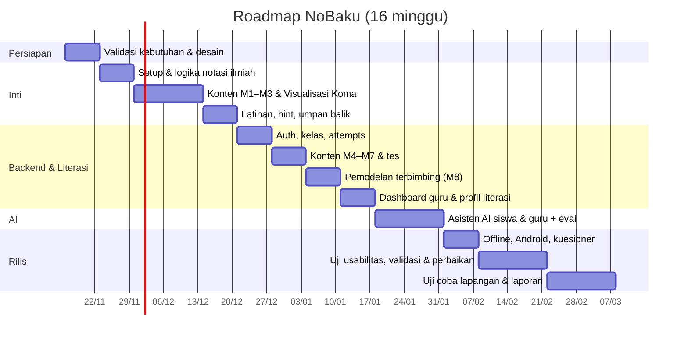

# Roadmap Pengembangan

Estimasi total **16 minggu** (1 minggu persiapan + 15 minggu pengembangan & evaluasi) dengan 1 pengembang; dapat disesuaikan dengan jadwal kuliah. Model kerja: sprint 1 minggu, review progres tiap akhir minggu.

Prinsip urutan: fitur inti yang menjawab temuan wawancara (visualisasi koma, pangkat negatif, umpan balik) dan **pemodelan terbimbing** dibangun lebih dulu. **Asisten AI** dibangun setelah fondasi mesin (`app/sci`, evaluator ekspresi, registri satuan) stabil, karena AI bergantung pada mesin tersebut untuk verifikasi.

## Ringkasan Fase

## Rincian per Minggu

| Minggu | Fase | Pekerjaan | Deliverable / Milestone | FR |
|---|---|---|---|---|
| 0 | Persiapan | Tinjau dokumen dengan dosen; wawancara tambahan 3–5 siswa & 1 guru (termasuk soal cerita/AKM & penerimaan AI); finalisasi nama; wireframe high-fidelity (Figma); susun kisi-kisi tes literasi | Dokumen v1.2, desain Figma, kisi-kisi | — |
| 1 | Setup | Monorepo, Vite+React+TS+Tailwind, FastAPI skeleton, CI; `lib/sci` + `app/sci` (konversi, operasi, satuan, ekspresi) + `shared/test-vectors.json` | Semua test vectors lulus di FE & BE | NFR-07 |
| 2 | Konten & Visual | LessonPlayer, ConceptCard, StimulusCard, **CommaVisualizer** (auto, manual, hitung nol) | Demo visualisasi koma | FR-04, FR-05, FR-12 |
| 3 | Konten & Visual | Konten M1–M3 (JSON) dengan label literasi, contoh terurai & faded, langkah terpandu | Modul 1–3 dapat dijalani | FR-03, FR-06, FR-07, FR-11, FR-21 |
| 4 | Latihan | Latihan L1–L4, SciInput + keypad, hint bertingkat, diagnosis kesalahan | **Alpha** (tanpa login) — uji cepat ke 2 siswa | FR-08, FR-09, FR-10 |
| 5 | Backend | Model DB, Alembic, auth JWT, kelas & kode, attempts + batch answers, progres | API terdokumentasi di `/docs` | FR-01, FR-02, FR-15 |
| 6 | Konten | Konten M4–M7, soal cerita terstruktur, operasi kali/bagi, pre/post-test prosedural & literasi (format AKM), kuis modul | Modul 1–7 lengkap | FR-13, FR-14, FR-22, FR-24, FR-29 |
| 7 | Pemodelan | ModelingStepper, QuantityCard, UnitConverter, ExpressionBuilder, pemeriksa langkah PMSTP, konten M8 (24+ soal, 8 jenis model, 3 konteks) | Modul 8 dapat dijalani offline | FR-23, FR-24 |
| 8 | Guru & Literasi | Dashboard guru: ringkasan, matriks, peta kesalahan, aksi, ekspor CSV; profil literasi siswa & kelas | **Beta** (semua fitur non-AI) | FR-16, FR-27 |
| 9 | AI | `app/ai`: ModelSpec, prompt ekstraksi & petunjuk, guardrails, kuota, cache, anggaran; UI "Bawa Soalmu"; set evaluasi AI (60+15 soal) | Asisten AI siswa berjalan di staging | FR-25, FR-28 |
| 10 | AI | Asisten AI guru (draf → verifikasi → tinjau → setujui), pengaturan AI kelas, laporan penggunaan AI; jalankan eval AI & perbaiki prompt | Eval AI memenuhi target | FR-26, FR-28 |
| 11 | Rilis | PWA offline + antrian sinkronisasi; Capacitor Android + APK bertanda tangan; kuesioner Paas; ekspor penelitian | APK terpasang di HP uji | FR-17, FR-18, FR-19 |
| 12 | Evaluasi | Uji usabilitas 5 siswa (think-aloud + SUS, termasuk pemodelan & AI); validasi ahli materi, media, dan instrumen literasi; uji coba terbatas instrumen | Laporan usabilitas & validasi | — |
| 13 | Perbaikan | Perbaiki temuan; aksesibilitas & kinerja (Lighthouse); hardening keamanan; finalisasi instrumen | **v1.0** | NFR-02, NFR-04, NFR-05, NFR-13–15 |
| 14 | Uji coba | Uji coba di kelas: pre-test (prosedural + literasi) → modul 1–8 (+ AI bila disetujui) → post-test → kuesioner | Data penelitian | — |
| 15 | Laporan | Analisis data (N-gain prosedural & literasi, Paas, kesalahan, penggunaan AI), wawancara lanjutan, dokumentasi akhir | Laporan akhir & presentasi | — |

## Milestone

| Milestone | Kriteria keberhasilan |
|---|---|
| M-Alpha (akhir minggu 4) | Siswa dapat belajar Modul 1–3 lengkap di browser dengan umpan balik & hint |
| M-Beta (akhir minggu 8) | Login, kelas, 8 modul, pemodelan terbimbing, pre/post-test, dashboard guru & profil literasi berfungsi online |
| M-AI (akhir minggu 10) | Asisten AI siswa & guru lolos target evaluasi di [AI-TUTOR.md](AI-TUTOR.md#8-evaluasi-kualitas-ai) |
| M-v1.0 (akhir minggu 13) | PWA + APK, offline, lolos kriteria rilis di [TESTING-PLAN.md](TESTING-PLAN.md#kriteria-rilis-v10) |
| M-Evaluasi (akhir minggu 15) | Data uji coba dianalisis dan dilaporkan |

## Backlog Fase 2 (setelah MVP)
- Soal cerita lintas materi SMP (persamaan linear, perbandingan, aritmetika sosial) dengan mesin pemodelan yang sama.
- Input foto soal untuk Asisten AI.
- Bab Bilangan Berpangkat lainnya (sifat perpangkatan, bentuk akar).
- Latihan ulang terjadwal (*spaced repetition*) untuk mengatasi lupa (EL01).
- Self-explanation lengkap (FR-20).
- Rilis Google Play Store.
- Mode kelas langsung (guru memulai sesi kuis bersama).

## Manajemen Risiko Jadwal
- Jika terlambat, urutan yang dapat ditunda: FR-20 → FR-26 (AI guru) → FR-25 (AI siswa) → FR-19 → FR-17 tambahan (IL/EL/GL) → FR-18 offline (diganti "butuh internet").
- Fitur **tidak boleh** ditunda: Visualisasi Koma (F-03), Modul Pangkat Negatif, umpan balik & diagnosis, **pemodelan terbimbing (F-16)**, dan profil literasi (F-19) — ini inti jawaban atas temuan wawancara dan tujuan literasi.
